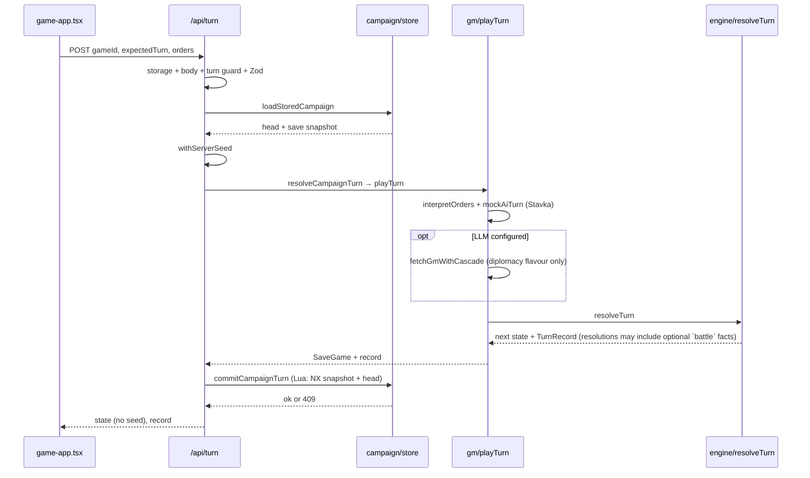
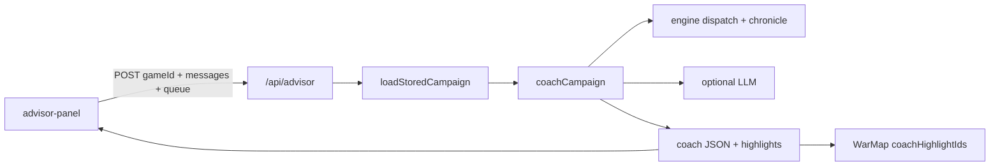

# Ostfront architecture

Turn-based browser wargame (Next.js, TypeScript, MapLibre) for the Gorlice–Tarnów offensive, May–July 1915. This document is a **codemap**: where requests go, what owns truth, and which files to open when debugging.

Raymond’s learning question — *where is the POST, turn guard, and server→client send-back?* — is answered in **Turn flow** below.

**Related:** `README.md` (introduction), `docs/RULES.md` (full player rules), `docs/DEVELOPMENT.md` (local run and env), `FEATURES.md` (QA-visible behaviour), `docs/decisions/` (ADRs).

---

## Bird’s-eye view

```text
Browser (components/game-app.tsx)
    │  POST { gameId, expectedTurn, orders }
    ▼
app/api/turn/route.ts          ← turn guard, load store, resolve, commit
    ├─ lib/api/turn-guard.ts
    ├─ lib/campaign/store.ts   ← Upstash Redis or in-memory
    ├─ lib/campaign/resolve-turn.ts → lib/gm/index.ts playTurn
    │       └─ lib/engine/turn.ts resolveTurn
    └─ lib/campaign/public-state.ts stripSeedFromState
    │  JSON { gameId, state, record }
    ▼
Browser updates map, optional Log drawer chronicle, clears order queue
```

| Layer | Role | Search here |
| --- | --- | --- |
| `app/` | Pages and HTTP routes | `app/api/*/route.ts` |
| `components/` | Map, HUD, panels | `game-app.tsx` (branches to `campaign-start.tsx` pre-Begin), `war-map.tsx`, `hud.tsx`, `hud-options-menu.tsx`, `floating-window.tsx`, `document-tray.tsx`, `ohl-orders-window.tsx`, `odds-bar.tsx` |
| `lib/ui/` | Client-only UX helpers (not engine truth) | `legal-targets.ts`, `odds-band.ts`, `goal-copy.ts`, `campaign-shell.ts`, `table-windows.ts`, `teach-windows.ts`, `document-tray.ts`, `window-drag.ts`, `use-desktop-shell.ts`, `map-hover.ts`, `map-target-style.ts`, `types.ts` |
| `lib/engine/` | Rules of war (ground truth) | `turn.ts`, `simultaneous.ts`, `combat.ts` |
| `lib/gm/` | Orders → proposals, LLM cascade, advisor | `index.ts`, `interpret.ts`, `cascade.ts`, `advisor.ts` |
| `lib/ai/` | Rule-based Stavka | `stavka.ts` |
| `lib/campaign/` | Server saves, public JSON | `store.ts`, `resolve-turn.ts`, `public-state.ts` |
| `lib/redis/` | Upstash REST client, env, test fake | `env.ts`, `client.ts`, `fake-client.ts` |
| `lib/data/` | Scenario, map, objectives | `scenario.ts`, `objectives.ts`, `theater-geometry.json` |
| `lib/news/` | Post-turn headline cards (client-only) | `select.ts`, `lore.ts`, `images.ts`, `battle.ts`, `types.ts` |
| `lib/teach/` | Lesson drills (no full campaign) | `lessons.ts`, `resolve.ts`, `record.ts` |
| `tests/` | Vitest specs per mechanic | `npm test` |
| `scripts/` | Map build, balance sim, `demo-check` | `scripts/demo-check.mjs` |
| `.github/workflows/ci.yml` | `typecheck`, `lint`, `test`, webpack `build` | CI job `check` |

Stack: Next.js App Router, React client components for the game shell, server routes for adjudication. Map rendering uses MapLibre (`components/war-map.tsx`, worker in `public/maplibre-gl-worker.mjs`).

### Map rendering (`components/war-map.tsx`)

| Piece | Role |
| --- | --- |
| `lib/map/province-label-layers.ts` | GeoJSON for `province-labels` / `province-counters`, glyph URL, counter pill image |
| `lib/map/war-map-layers.ts` | Layer stack: rail casing+track above borders (under labels/counters), symbol labels above selection outline, feature-state `role` fills |
| `lib/map/province-paint.ts` | Shared fill/lift/`roleFor` for MapLibre and `components/svg-map.tsx` fallback. Overlay `resources` shades `provinceResourceYield` (local mp+ip; national multipliers stay off the colour) |
| `lib/map/target-highlight.ts` | Feature-state roles + `target-fill` opacity pulse (snap + MapLibre paint transition) so selection switches fade like first select |
| `lib/map/lesson-highlight.ts` | `/teach` brass focus fill + target/source outlines; pulse respects `prefers-reduced-motion` |
| `lib/map/rail-lines.ts` + `shared-border.ts` | Rail paths via shared-border midpoints, not anchor-to-anchor chords |
| `lib/ui/legal-targets.ts` | `reach` + `canOrder`; Russian provinces get reach hints without orders; `neighborTargetIds` / `isNeighborOrderTarget` gate map-arrow drops (UI only — engine still validates) |
| `lib/ui/drag-order.ts` | Pure chip-drag reducer. Chips (`components/army-chips.tsx`) show at zoom ≥ 7.4. A legal drop queues one Central Powers formation; an illegal drop returns the same queue. Edge pan is UI only. The engine still accepts or rejects the order at resolve |
| `lib/ui/selection.ts` | Click-toggle and Escape deselect in `game-app.tsx` / `teaching-app.tsx` (no startup auto-select; Province starts empty until the player clicks) |
| `lib/ui/teach-windows.ts` | Desktop `/teach` floating window ids (Lesson, Orders, Province, Legend) and z-order helpers |
| `public/fonts/` | Self-hosted MapLibre glyph PBFs (Noto Serif incl. ★/◆ ranges, Open Sans) |

Province labels are **MapLibre symbol layers**, not HTML markers. WebGL paints directly (no canvas blit). ADR 009.

### Campaign shell (general's table)

**Client lifecycle** (`lib/ui/campaign-shell.ts`, `components/game-app.tsx`): a discriminated-union reducer replaces the former `setupOpen` / `busy` / `beginBusy` / `staleCampaign` / `resultOpen` boolean lattice. States are **setup** (`begin` idle or pending) or **table** (requires `gameId`, `turn` idle or pending, optional `stale`, session `resultOpen` for the grade modal). Boot uses `peekSave()` so a local snapshot **without** `gameId` stays on setup — never the live table. `loadGame()` remains strict (server id required) for hydration and auto-save.

| Viewport | Layout |
| --- | --- |
| Desktop (`lg+`, ≥1024px) | Full-width map; no fixed 23rem right dock. Parchment floating windows (`lib/ui/table-windows.ts`, `components/floating-window.tsx`): Orders, Province, Log, Legend, Chief of Staff, Orders from OHL. Slim HUD (`components/hud.tsx`, `[data-testid=table-hud]`) keeps title / strength, treasury, VP, and grade (no provinces-held count) / date — **not** window toggles and **not** Chief of Staff; **Options** gear (`components/hud-options-menu.tsx`) sits beside the date (Restart + disabled Settings). Stowed papers sit in the bottom **document tray** (`components/document-tray.tsx`, `lib/ui/document-tray.ts`, `z-[40]`); drag a tab up (or Enter) restores at the drop / soft point with width and last height retained; drag onto the whole tray bar (highlight + insert marker) files at the drop slot, or Escape files — sideways tab drag / Alt+←/→ reorders (`trayOrder` in sessionStorage); no Stow buttons or click-to-toggle. Papers use z above the tray so they never paint behind it; drag and resting Y (and session restore) keep the header grip fully above the tray (map stage is below the HUD, so saved positions never sit under the top bar). Header press–drag–release with pointer capture (`lib/ui/window-drag.ts`; `pointercancel` / `lostpointercapture` still finish); file on tray / below / viewport-bottom release; height locked while dragging (optional resize handle). Default-open after Begin: Orders, Legend, OHL. Escape: news → file topmost → deselect. SessionStorage remembers open/xy/z/width/height for the tab. |
| Below `lg` | Stacked map + aside; phone **document tray** (`CAMPAIGN_PHONE_TRAY_ITEMS`) swaps Orders / Province / **Chief of Staff** (embedded advisor) following `trayOrder`. Map-corner Log stays above the legend through tablet widths (640–1023px). Campaign goal is a dismissible OHL strip, not the HUD strength block. Compact HUD (Options gear only — no Chief of Staff) with wrapped stats; no overflow at 390×844. |
| `/teach` | Same tray model (`lib/ui/teach-windows.ts`): Lesson, Orders, Province, Legend. Same slim HUD with `[data-testid=teach-goal]` (lesson title) and Options menu; hides campaign scoring. Default-open: Lesson top-left, Legend under it, Orders top-right — height caps keep the left column clear of map targets. One Resolve in Lesson (`teach-resolve`, pinned footer); Orders omits end-turn. Brass lesson-focus outlines (`data-lesson-highlights`). Below `lg`: `h-dvh` stack — capped map, bounded Lesson (`teach-lesson-stack`) with Resolve in-viewport, then phone tray swapping Orders/Province/Legend. |

**Palette tokens** (`app/globals.css`): `--paper`, `--paper-deep`, `--ink`, `--ink-muted`, `--leather`, `--brass`, `--brass-deep` / `--primary` (chrome text ≥4.5:1 on paper); faction `--faction-central` / `--faction-russia` (map paint unchanged). HUD strip (`.table-hud`, `HUD_Z` above `PAPER_DRAG_Z` so the Options dropdown is never covered by a paper drag-handle), Options menu, tray paper-tabs, map-mode/zoom, news/modals, and phone Log sheets share this chrome.

ADR 010 (campaign), ADR 011 (`/teach`), ADR 012 (document tray), ADR 013 (slim HUD Options menu).

---

## Turn flow (campaign)

### Client: close the fortnight

In `components/game-app.tsx`, `endTurn`:

1. Builds `PlayerOrder[]` from the queue (`queuedToPlayerOrders`) plus optional text directive.
2. Requires `game.gameId` (from `POST /api/new-game`); otherwise shows an error.
3. `fetch("/api/turn", { method: "POST", body: { gameId, expectedTurn: game.state.turn, orders } })`.
4. On success: merges `payload.state` and `payload.record` into React state, clears queue, flashes control changes, and runs `selectNewsEvents(prev, next, record)` to queue HOI4-style news cards (`NewsCardQueue`).
5. On failure: leaves map and queue unchanged; sets shell `stale` for `stale_turn` / `unknown_game` / missing `gameId`.

Local persistence: `lib/storage.ts` writes `gameId` + seed-stripped state to `localStorage` (`ostfront-1915-v1`) after play. `loadGame()` requires `gameId`; `peekSave()` reads the slot for boot. On load, a one-shot `GET /api/game?gameId=…` refreshes from the server.

### Server: `app/api/turn/route.ts`

Gate order (first failure wins):

| Step | Check | Typical HTTP |
| --- | --- | --- |
| 1 | `campaignStorageStatus()` — Redis REST creds required on Vercel | 503 `storage_unavailable` |
| 2 | `readBodyWithLimit` | 413 payload too large |
| 3 | `enforceTurnGuards` — size again, rate limit, origin/token | 429 / 403 / 401 |
| 4 | `JSON.parse` | 400 invalid JSON |
| 5 | `ServerTurnRequestSchema` (Zod) — **only** `gameId`, `expectedTurn`, `orders` | 400 schema |
| 6 | `loadStoredCampaign` | 404 `unknown_game` |
| 7 | `head.turn === expectedTurn` | 409 `stale_turn` |
| 8 | `withServerSeed(state, head.seed)` | — |
| 9 | `resolveCampaignTurn` → `playTurn` | 409 `stale_turn` / `campaign_closed` / 400 `missing_game` |
| 10 | `commitCampaignTurn` — atomic Redis Lua or in-memory serialize | 409 `storage_conflict` or `stale_turn` |
| 11 | Response | 200 `{ gameId, state: stripSeedFromState(...), record }` |

Turn guard defaults (`lib/api/turn-guard.ts`): body ≤ 512_000 bytes; 24 requests per IP per 60s per warm instance; optional `TURN_API_TOKEN` and `TURN_ALLOWED_ORIGINS`. Access (`checkAccess`): a matching `X-Ostfront-Turn-Token` or `Authorization: Bearer` value always passes; else, if `TURN_ALLOWED_ORIGINS` is non-empty, the request must carry a matching `Origin`/`Referer` (**403** if missing or not listed) and **does not need the token**; else, if only a token is configured, missing credentials yield **401**; with neither token nor allow-list, the route is open (typical local dev).

### Resolution chain



**Key functions**

- `resolveCampaignTurn` — `lib/campaign/resolve-turn.ts`
- `playTurn` — `lib/gm/index.ts`
- `mockAiTurn` → `stavkaTurn` — `lib/gm/mock.ts`, `lib/ai/stavka.ts`
- `resolveTurn` — `lib/engine/turn.ts`

### Storage layout (Upstash Redis)

`lib/campaign/store.ts` with keys from `lib/campaign/redis-keys.ts`:

| Key | Payload |
| --- | --- |
| `campaign:{gameId}:head` | `CampaignHead` — `turn`, **authoritative `seed`**, `difficulty`, `createdAt` |
| `campaign:{gameId}:turn:{n}` | `TurnSnapshot` — `SaveGame` **without** `state.seed` |

- **Create:** `CREATE_CAMPAIGN_LUA` — dual `SET NX` with 30-day TTL (`CAMPAIGN_TTL_SECONDS`).
- **Commit:** `COMMIT_TURN_LUA` — one atomic step: verify expected turn, `SET NX` on turn `N+1`, write new head. Losers → **409** (`storage_conflict` or `stale_turn`). Fixes the old Blob orphan-snapshot failure mode (ADR 004, superseded).
- **Game over:** `resolveTurn` still advances `state.turn` after a grade is set (so commit sees `expectedTurn + 1`), but leaves `state.date` on the fortnight that closed — final map stays on e.g. 11 July before the grade screen (ADR 014 / issue #62). HUD fortnight uses `Math.min(turn + 1, scenario length)`.
- **No Redis creds:** in-memory `Map` for local dev and Vitest (`campaignStorageMode(): "memory"`).
- **Vercel without creds:** `lib/campaign/availability.ts` → **503** fail closed.

Teach persistence: `teach:attempt:{day}:{id}`, `teach:belief:{attemptId}` in `lib/teach/record.ts` and `lib/teach/belief.ts`.

Legacy Blob campaigns are not migrated.

---

## Advisor / campaign coach (`POST /api/advisor`)

Phase **2E round 1** (ADR 015). `components/advisor-panel.tsx` sends `{ gameId, expectedTurn, messages, queuedOrders, selectedProvinceId? }` only — **no** client `GameState`. Route: `app/api/advisor/route.ts`.

Same turn guard as turn (body limit, rate, origin/token) **plus** campaign storage: `loadStoredCampaign` → 404 `unknown_game`; `expectedTurn` mismatch → 409 `stale_turn`; `withServerSeed` for the coach dispatch. Seed never returns to the client.

`lib/gm/campaign-coach.ts` `coachCampaign()`:

- Builds the engine dispatch via `buildSituation` / `renderSituation` (`lib/gm/advisor.ts`) plus chronicle from `save.log` (`BattleFacts`, routine lines).
- Optional LLM via the provider chain (OpenAI, then the `LLM_*` backup); else rules fallback. Schema **forbids** `suggestions` / order objects.
- Returns `{ reply, followUp, highlights, source, unavailable, ordersClosed }`. Highlights are province / `uiId` pointers; `game-app` maps them to `WarMap` `coachHighlightIds`.

Coach does **not** persist chat on the server (sessionStorage only).

**Offline scenario eval** (`npm run eval:coach`, ADR 015): `lib/gm/coach-eval/` builds eight fixed `GameState` fixtures (including fortify+attack conflicts), runs `coachCampaign`, and applies Layer 1 deterministic hard-rule checks (sentence budget, question-first, no filed claims / banned jargon / dangling odds clauses, grounded odds & chronicle fortnight). Live mode (when `OPENAI_API_KEY` or `LLM_API_KEY` is set) adds a Layer 2 pedagogy rubric grader on the first provider (`EVAL_JUDGE_MODEL` optional). `tests/coach-eval.test.ts` keeps fixtures and Layer 1 in CI without external APIs. Coach post-processing drops whole comparison clauses when scrubbing a second odds figure; the advisor panel aborts hung `/api/advisor` fetches client-side.



---

## Teach mode (`app/teach/`, `/api/teach/*`)

Isolated lessons (e.g. converging attacks) without a `gameId`. State is **built on the server** from lesson id + variant, not trusted from the client.

| Route | Role |
| --- | --- |
| `GET /api/teach/session` | Lesson meta, authoritative `state`, hints, trust copy |
| `POST /api/teach/hint` | Levelled hint from `coachHints` |
| `POST /api/teach/coach` | Reasoning coach (LLM optional) |
| `POST /api/teach/resolve` | Validates orders; `teachResolveTurn`; may persist attempt to Redis |

`lib/teach/resolve.ts` uses fixed combat rolls in guided/silent variants (stated in session JSON). Belief fields are server-owned; hostile client fields → 400.

UI: `components/teaching-app.tsx`, `teach-panel.tsx` — desktop general’s-table shell (ADR 011); lesson-focus map layers via `lessonFocus` on `WarMap`.

---

## Other API routes

| Route | Purpose |
| --- | --- |
| `POST /api/new-game` | `createStoredCampaign` → `publicSavePayload` |
| `GET /api/game?gameId=` | Load latest snapshot; `withServerSeed` then strip seed in JSON |

---

## Game rules (code pointers)

Numbers below are from source, not paraphrase.

### Combat and concentric attacks (`lib/engine/combat.ts`)

- Flank multiplier: 2 prongs ×1.12, 3 ×1.22, 4+ ×1.30 (`flankMultiplier`).
- Encirclement extra defender loss fraction: **0.18** (`ENCIRCLEMENT_DEFENDER_LOSS`); applied in `simultaneous.ts` when multi-prong attack and **no retreat neighbor at turn open** (`exitAtStart.length === 0`).
- Terrain defense: plains 1, forest 1.2, urban 1.18, marsh 1.35, mountain 1.48.
- Fort: +14% defense per level (`defenderPower`).
- Die band 0.82–1.17 (`resolveCombat`).

### Fortify (`lib/engine/economy.ts`, `lib/engine/turn.ts`)

- Cost **2 IP** (`FORTIFY_IP_COST`); treasury deducted when proposal accepted.

### Supply (`lib/engine/supply.ts`)

- March/attack requires province supply ≥ **30** (rejection in `turn.ts`).
- Converging flank bonus needs attack supply ≥ **60** (`CONVERGING_FLANK_MIN_SUPPLY`).
- Capacity by terrain (e.g. urban 62, plains 44) plus depot +34, +6 per rail edge.
- Depot attacks floor at **72%** of network supply (`DEPOT_ATTACK_SUPPLY_FLOOR`).

### Economy highlights (`lib/engine/economy.ts`)

- Province yield: base × (1 − unrest/100), ×0.5 when `controller !== owner`, and **0** when supply is under **30** (`INCOME_SUPPLY_FLOOR`). The HUD breakdown prints that rule once, then a terse line per held province (`1 MP, 1 IND`, or `0 (supply 27 < 30)`).
- Central Powers industry × **1.3** (`CENTRAL_INDUSTRY_MULTIPLIER`), then one round (`projectIncome` / `explainIncome`). Russian manpower ×1.12, industry ×0.55, then `DIFFICULTY_INCOME` (easy 0.62, normal 0.82, hard 1.18).
- Reinforcements: up to **8** strength at **1 manpower per 4** (`POINTS_PER_MP`) for formations in supply ≥ **50** that are not attacking (`explainRefit`). The HUD states that cost in one sentence and does not print the bill. Industry’s breakdown also shows ×1.3; manpower’s does not.
- Resources map lens (`PaintOverlayMode` `"resources"`, `[data-testid=map-mode-resources]`) shades that local yield. It does not apply the national multipliers and does not print MP/IND labels. The province panel shows the same terse yield for the selected province (`[data-testid=province-yield]`).
- Map hover notes that describe the order origin (supply under 30, no unassigned formation) appear only on that province (`mapProvinceHoverNote` in `lib/ui/legal-targets.ts`). Neighbor arrows still carry the refusal in the orders hint via `legalTargetHoverNote`.
- Recruit costs and arrivals in `RECRUIT` table (infantry 6 mp / 3 ip, etc.).
- Yards: controller match, supply ≥ **60**, depot or own urban city (`recruitmentYard`).

### Victory (`lib/data/objectives.ts`, `lib/engine/victory.ts`)

Gorlice scenario (`SCENARIOS.gorlice`):

| Objective | VP | Brilliant par turn |
| --- | ---: | ---: |
| Lemberg (`lwow`) | 4 | turn ≤ 3 (13 June) |
| Lublin | 2 | turn ≤ 5 (11 July) |
| Rovno (`wolyn`) | 3 | turn ≤ 4 (27 June) |
| Kraków (home) | 2 | must stay Central Powers |

Grade thresholds (eastern VP captured, Kraków not Russian): Decisive ≥ **7**, Victory ≥ **4**, Marginal ≥ **2**; Brilliant needs all eastern objectives on par turns and no `homeLost`. Kraków Russian at end → defeat paths in `decideFortnight`.

---

## AI and game master

### Stavka (always runs)

`playTurn` always calls `mockAiTurn` → `stavkaTurn` for Russian **proposals**. Difficulty sets attack thresholds (`STAVKA_THRESHOLD` in `lib/ai/stavka.ts`).

### LLM provider chain (`lib/gm/providers.ts`, `lib/gm/cascade.ts`)

When `OPENAI_API_KEY` and/or `LLM_API_KEY` is set, `fetchGmWithCascade` tries providers in order (ADR 018):

1. OpenAI (`OPENAI_MODEL`, default `gpt-6.1-terra`; `reasoning_effort` from `OPENAI_REASONING_EFFORT`, default `medium`) and strict `json_schema`.
2. The existing `LLM_*` client (OpenRouter in production), including `planCascade` / `LLM_MODEL_STRONG` inside that provider only.
3. **Staff simulation** (Stavka only) if neither returns valid JSON.

The first provider gets about half of `GM_BUDGET_MS` so the backup still fits. Failover covers timeout, 429, 5xx, a missing key, an empty body, and unparseable or invalid JSON. Logs name the provider and model.

**Surprising fact (verify in `lib/gm/index.ts`):** even when a provider succeeds, **only up to two diplomacy lines** are taken from the LLM. Russian unit orders, events, and narration still come from Stavka.

### Advisor and teach coach

`/api/advisor` (`coachCampaign`) and `POST /api/teach/coach` use `llmChatChain` with the same provider order and a strict coach schema on OpenAI. The dispatch is still built in `lib/gm/advisor.ts`. They do not use the turn cascade's strong model.

### LLM Blob logging (`lib/gm/llm-log.ts`)

Opt-in only (`LLM_LOG_BLOB`, plus `LLM_LOG_BLOB_PREVIEW` on preview). Default: console JSON only — no Blob advanced ops on the request path.

---

## Invariants and trust boundaries

| Asset | Owner | Notes |
| --- | --- | --- |
| Dice seed | Server `CampaignHead` only | Never in API JSON or turn snapshots (`stripSeedFromState` on responses) |
| Campaign snapshots | Server Redis / memory | Client sends only `gameId` + turn index + orders |
| Turn outcome | `lib/engine` | Deterministic given seed + orders + Stavka |
| Advisor map view | **Client POSTed state** | Trusts browser for briefing; does not change saved campaign |
| Teach lesson state | Server `authoritativeLessonState` | Client cannot substitute another scenario |
| localStorage save | Browser | Convenience cache; can be stale until `/api/game` sync |

Engine is **ground truth** for adjudication. AI proposes; `resolveTurn` decides.

---

## Known gaps and surprising facts

1. **LLM turn cascade is mostly cosmetic today** — only diplomacy flavour reaches the chronicle; Stavka still moves Russia.
2. **`measureRejectionRate` in cascade** dry-runs LLM proposals to choose escalation, but those proposals are not used in the live turn.
3. **`lib/storage.ts` is not dead code** — `game-app.tsx` still mirrors saves locally; server campaigns are authoritative for adjudication.
4. **Turn guard rate limit** is per serverless instance, not global.
5. **In-memory dev store** serializes commits per `gameId` via `runCampaignSerialized`; Redis relies on Lua for parallel safety.

---

## Glossary

| Term | Meaning |
| --- | --- |
| **Fortnight** | One turn (~two weeks); turn index 0…5 in Gorlice scenario |
| **Stavka** | Rule-based Russian AI in `lib/ai/stavka.ts` |
| **GM** | Game master package (`lib/gm/`) — interpret, LLM, advisor |
| **Cascade** | Fast LLM call, optional strong-model retry (`lib/gm/cascade.ts`) |
| **Tier** | Turn importance score for model routing (`lib/gm/tier.ts`) |
| **Dispatch** | Advisor briefing blob built from engine previews |
| **Echelon** | Unit grouping / corps structure (`lib/engine/echelon.ts`) |
| **Lua CAS** | Atomic turn commit script in `lib/campaign/redis-scripts.ts` |
| **Proposal** | Typed order (move, attack, fortify, …) before resolution |
| **Chronicle** | `TurnRecord` in non-modal Log drawer (`chronicle-drawer.tsx` + `timeline-panel.tsx`); routine via `routineLog` (battle rows show compact loss lines from `Resolution.battle`), full summaries behind **Details** |
| **BattleFacts** | Optional `Resolution.battle` set in `resolveManeuvers` for assaults and meeting engagements that already log losses; includes sorted `origins` for news map arrows, plus structured pre-roll `attack`/`defense`/`ratio`/`roll`, launch-supply per origin, and converging `pooledSupply` when applicable. `/teach` grading (`lib/teach/feedback.ts`, `supply-feedback.ts`) reads these fields via `lib/teach/battle-from-record.ts` — not summary regex. |
| **applyAttack** | Thin wrapper over `resolveManeuvers` for advisor legality dry-runs and tests; live fortnights always resolve combat through `resolveManeuvers`. |
| **News card** | Client headline overlay after a fortnight (`components/news-card.tsx`, `lib/news/select.ts`); priority objective → encirclement → city → depot; wins over Log for Escape |
| **General's table** | Desktop (`lg+`) parchment floating windows for Orders / Province / Log / Legend / Advisor / OHL (clamped + scrollable); mobile keeps stacked aside (ADR 010) |

---

## CI and agents

- Local gate: `npm run typecheck`, `npm run lint -- --max-warnings=0`, `npm test`, `npm run build`.
- Preview QA: `DEMO_URL=… npm run demo-check` (see `AGENTS.md`).
- Coding agents: read this file first; update it and add an ADR when changing architecture, routes, storage, trust boundaries, or coded game rules.
