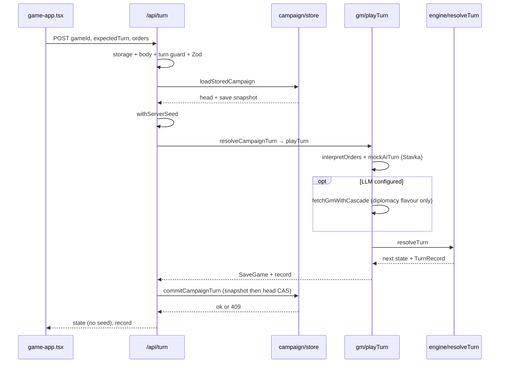
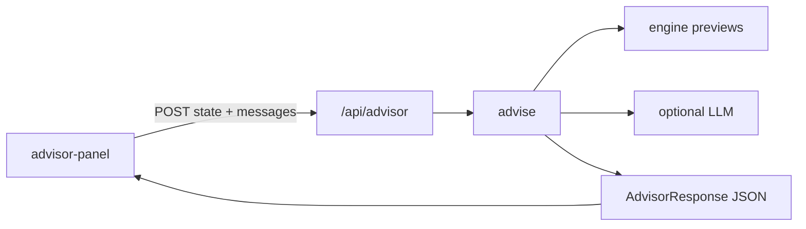

# Ostfront architecture

Turn-based browser wargame (Next.js, TypeScript, MapLibre) for the Gorlice–Tarnów offensive, May–July 1915. This document is a **codemap**: where requests go, what owns truth, and which files to open when debugging.

Raymond’s learning question — *where is the POST, turn guard, and server→client send-back?* — is answered in **Turn flow** below.

**Related:** `README.md` (player rules), `FEATURES.md` (QA-visible behaviour), `docs/decisions/` (ADRs). **In progress:** campaign storage may move from Vercel Blob to Upstash Redis (draft PR #45); this doc describes **current `main`**.

---

## Bird’s-eye view

```text
Browser (components/game-app.tsx)
    │  POST { gameId, expectedTurn, orders }
    ▼
app/api/turn/route.ts          ← turn guard, load store, resolve, commit
    ├─ lib/api/turn-guard.ts
    ├─ lib/campaign/store.ts   ← Blob or in-memory
    ├─ lib/campaign/resolve-turn.ts → lib/gm/index.ts playTurn
    │       └─ lib/engine/turn.ts resolveTurn
    └─ lib/campaign/public-state.ts stripSeedFromState
    │  JSON { gameId, state, record }
    ▼
Browser updates map, chronicle, clears order queue
```

| Layer | Role | Search here |
| --- | --- | --- |
| `app/` | Pages and HTTP routes | `app/api/*/route.ts` |
| `components/` | Map, HUD, panels | `game-app.tsx`, `war-map.tsx` |
| `lib/engine/` | Rules of war (ground truth) | `turn.ts`, `simultaneous.ts`, `combat.ts` |
| `lib/gm/` | Orders → proposals, LLM cascade, advisor | `index.ts`, `interpret.ts`, `cascade.ts`, `advisor.ts` |
| `lib/ai/` | Rule-based Stavka | `stavka.ts` |
| `lib/campaign/` | Server saves, public JSON | `store.ts`, `resolve-turn.ts`, `public-state.ts` |
| `lib/data/` | Scenario, map, objectives | `scenario.ts`, `objectives.ts`, `theater-geometry.json` |
| `lib/teach/` | Lesson drills (no full campaign) | `lessons.ts`, `resolve.ts`, `record.ts` |
| `tests/` | Vitest specs per mechanic | `npm test` |
| `scripts/` | Map build, balance sim, `demo-check` | `scripts/demo-check.mjs` |
| `.github/workflows/ci.yml` | `typecheck`, `lint`, `test`, webpack `build` | CI job `check` |

Stack: Next.js App Router, React client components for the game shell, server routes for adjudication. Map rendering uses MapLibre (`components/war-map.tsx`, worker in `public/maplibre-gl-worker.mjs`).

---

## Turn flow (campaign)

### Client: close the fortnight

In `components/game-app.tsx`, `endTurn`:

1. Builds `PlayerOrder[]` from the queue (`queuedToPlayerOrders`) plus optional text directive.
2. Requires `game.gameId` (from `POST /api/new-game`); otherwise shows an error.
3. `fetch("/api/turn", { method: "POST", body: { gameId, expectedTurn: game.state.turn, orders } })`.
4. On success: merges `payload.state` and `payload.record` into React state, clears queue, flashes control changes.
5. On failure: leaves map and queue unchanged; sets `staleCampaign` for `stale_turn` / `unknown_game`.

Local persistence: `lib/storage.ts` writes `gameId` + seed-stripped state to `localStorage` (`ostfront-1915-v1`) after play. On load, a one-shot `GET /api/game?gameId=…` refreshes from the server.

### Server: `app/api/turn/route.ts`

Gate order (first failure wins):

| Step | Check | Typical HTTP |
| --- | --- | --- |
| 1 | `campaignStorageStatus()` — Blob token required on Vercel | 503 `storage_unavailable` |
| 2 | `readBodyWithLimit` | 413 payload too large |
| 3 | `enforceTurnGuards` — size again, rate limit, origin/token | 429 / 403 / 401 |
| 4 | `JSON.parse` | 400 invalid JSON |
| 5 | `ServerTurnRequestSchema` (Zod) | 400 schema |
| 6 | `loadStoredCampaign` | 404 `unknown_game` |
| 7 | `head.turn === expectedTurn` | 409 `stale_turn` |
| 8 | `withServerSeed(state, head.seed)` | — |
| 9 | `resolveCampaignTurn` → `playTurn` | 409 `stale_turn` / `campaign_closed` / 400 `missing_game` |
| 10 | `commitCampaignTurn` | 409 `storage_conflict` or `stale_turn` |
| 11 | Response | 200 `{ gameId, state: stripSeedFromState(...), record }` |

Turn guard defaults (`lib/api/turn-guard.ts`): body ≤ 512_000 bytes; 24 requests per IP per 60s per warm instance; optional `TURN_API_TOKEN` and `TURN_ALLOWED_ORIGINS`. If a token is set but the page does not send it, every turn gets **401** (documented in code comments).

### Resolution chain



**Key functions**

- `resolveCampaignTurn` — `lib/campaign/resolve-turn.ts`
- `playTurn` — `lib/gm/index.ts`
- `mockAiTurn` → `stavkaTurn` — `lib/gm/mock.ts`, `lib/ai/stavka.ts`
- `resolveTurn` — `lib/engine/turn.ts`

### Storage layout (current main)

`lib/campaign/store.ts`, prefix `campaigns/{gameId}/`:

- `head.json` — `turn`, `seed`, `difficulty`, `createdAt`
- `turn-N.json` — immutable `SaveGame` after fortnight N

Commit: write `turn-(N+1).json` with `allowOverwrite: false`, then update `head` with `ifMatch: etag`. No token → in-memory `Map` (local/CI). Vercel without token → 503 (fail closed).

---

## Advisor flow (`POST /api/advisor`)

`components/advisor-panel.tsx` sends chat history, **full client `GameState`**, and queued orders. Route: `app/api/advisor/route.ts`.

Same turn guard as turn (body limit, rate, origin/token) but **no** campaign storage check.

`lib/gm/advisor.ts` `advise()`:

- Rebinds topology, builds a “dispatch” from engine previews (`engagementOdds`, supply, objectives).
- If `llmConfigured()`, calls the model; else rules-only fallback (`source: "rules"`, `unavailable: true`).
- Suggestions are validated with the same helpers as real orders; nothing is applied until the player accepts into the queue.

Advisor does **not** persist chat on the server in the campaign store.



---

## Teach mode (`app/teach/`, `/api/teach/*`)

Isolated lessons (e.g. converging attacks) without a `gameId`. State is **built on the server** from lesson id + variant, not trusted from the client.

| Route | Role |
| --- | --- |
| `GET /api/teach/session` | Lesson meta, authoritative `state`, hints, trust copy |
| `POST /api/teach/hint` | Levelled hint from `coachHints` |
| `POST /api/teach/coach` | Reasoning coach (LLM optional) |
| `POST /api/teach/resolve` | Validates orders; `teachResolveTurn`; may persist attempt to Blob |

`lib/teach/resolve.ts` uses fixed combat rolls in guided/silent variants (stated in session JSON). Belief fields are server-owned; hostile client fields → 400.

UI: `components/teaching-app.tsx`, `teach-panel.tsx`.

---

## Other API routes

| Route | Purpose |
| --- | --- |
| `POST /api/new-game` | `createStoredCampaign` → `publicSavePayload` |
| `GET /api/game?gameId=` | Load latest snapshot + seed applied server-side, seed stripped in response |

---

## Game rules (code pointers)

Numbers below are from source on `main`, not paraphrase.

### Combat and concentric attacks (`lib/engine/combat.ts`)

- Flank multiplier: 2 prongs ×1.12, 3 ×1.22, 4+ ×1.30 (`flankMultiplier`).
- Encirclement extra defender loss fraction: **0.18** (`ENCIRCLEMENT_DEFENDER_LOSS`); applied in `simultaneous.ts` when multi-prong attack and **no retreat neighbor at turn open** (`exitAtStart.length === 0`).
- Terrain defense: plains 1, forest 1.2, urban 1.18, marsh 1.35, mountain 1.48.
- Fort: +14% defense per level (`defenderPower`).
- Die band 0.82–1.17 (`resolveCombat`).

### Fortify (`lib/engine/economy.ts`, `lib/engine/turn.ts`)

- Cost **2 IP** (`FORTIFY_IP_COST`); treasury deducted when proposal accepted.

### Supply (`lib/engine/supply.ts`)

- March/attack requires province supply ≥ **30** (rejection in `turn.ts`).
- Converging flank bonus needs attack supply ≥ **60** (`CONVERGING_FLANK_MIN_SUPPLY`).
- Capacity by terrain (e.g. urban 62, plains 44) plus depot +34, +6 per rail edge.
- Depot attacks floor at **72%** of network supply (`DEPOT_ATTACK_SUPPLY_FLOOR`).

### Economy highlights (`lib/engine/economy.ts`)

- Recruit costs and arrivals in `RECRUIT` table (infantry 6 mp / 3 ip, etc.).
- Russian income scale: easy 0.62, normal 0.82, hard 1.18 (`DIFFICULTY_INCOME`).
- Yards: controller match, supply ≥ **60**, depot or own urban city (`recruitmentYard`).

### Victory (`lib/data/objectives.ts`, `lib/engine/victory.ts`)

Gorlice scenario (`SCENARIOS.gorlice`):

| Objective | VP | Brilliant par turn |
| --- | ---: | ---: |
| Lemberg (`lwow`) | 4 | turn ≤ 3 (13 June) |
| Lublin | 2 | turn ≤ 5 (11 July) |
| Rovno (`wolyn`) | 3 | turn ≤ 4 (27 June) |
| Kraków (home) | 2 | must stay Central Powers |

Grade thresholds (eastern VP captured, Kraków not Russian): Decisive ≥ **7**, Victory ≥ **4**, Marginal ≥ **2**; Brilliant needs all eastern objectives on par turns and no `homeLost`. Kraków Russian at end → defeat paths in `decideFortnight`.

---

## AI and game master

### Stavka (always runs)

`playTurn` always calls `mockAiTurn` → `stavkaTurn` for Russian **proposals**. Difficulty sets attack thresholds (`STAVKA_THRESHOLD` in `lib/ai/stavka.ts`).

### LLM cascade (`lib/gm/cascade.ts`)

When `LLM_API_KEY` is set, `fetchGmWithCascade` calls `llmAiTurn` with:

- Primary model: `LLM_MODEL` or default `gpt-4o-mini`
- Escalation: `LLM_MODEL_STRONG` if set and distinct, on important/critical tiers (`lib/gm/tier.ts`) or high proposal rejection rate (> **0.3**) or invalid JSON on first attempt

**Surprising fact (verify in `lib/gm/index.ts`):** even when the cascade succeeds, **only up to two diplomacy lines** are taken from the LLM. Russian unit orders, events, and narration still come from Stavka. Failed cascade → staff simulation with a player-facing warning; `buildStaffTurn` still merges `interpreted` Central Powers proposals with Stavka’s Russian proposals.

Escalation never runs if `LLM_MODEL_STRONG` is unset or equal to `LLM_MODEL` (`resolveLlmModels`).

### Advisor

Separate prompt in `lib/gm/advisor.ts`; uses `llmChat`, not the turn cascade.

---

## Invariants and trust boundaries

| Asset | Owner | Notes |
| --- | --- | --- |
| Dice seed | Server `head.json` | Never in API responses (`stripSeedFromState`) |
| Campaign snapshots | Server Blob / memory | Client sends only `gameId` + turn index + orders |
| Turn outcome | `lib/engine` | Deterministic given seed + orders + Stavka |
| Advisor map view | **Client POSTed state** | Trusts browser for briefing; does not change saved campaign |
| Teach lesson state | Server `authoritativeLessonState` | Client cannot substitute another scenario |
| localStorage save | Browser | Convenience cache; can be stale until `/api/game` sync |

Engine is **ground truth** for adjudication. AI proposes; `resolveTurn` decides.

---

## Known gaps and surprising facts

1. **LLM turn cascade is mostly cosmetic today** — only diplomacy flavour reaches the chronicle; Stavka still moves Russia.
2. **`measureRejectionRate` in cascade** dry-runs LLM proposals to choose escalation, but those proposals are not used in the live turn.
3. **`lib/storage.ts` is not dead code** — `game-app.tsx` still mirrors saves locally; server campaigns are authoritative for adjudication.
4. **Turn guard rate limit** is per serverless instance, not global.
5. **Blob two-step commit** can orphan a snapshot if head CAS fails (see ADR 004; Redis migration in PR #45).
6. **README** still describes pre–round-2 local-only persistence in places; live play expects `gameId` from `/api/new-game`.

---

## Glossary

| Term | Meaning |
| --- | --- |
| **Fortnight** | One turn (~two weeks); turn index 0…5 in Gorlice scenario |
| **Stavka** | Rule-based Russian AI in `lib/ai/stavka.ts` |
| **GM** | Game master package (`lib/gm/`) — interpret, LLM, advisor |
| **Cascade** | Fast LLM call, optional strong-model retry (`lib/gm/cascade.ts`) |
| **Tier** | Turn importance score for model routing (`lib/gm/tier.ts`) |
| **Dispatch** | Advisor briefing blob built from engine previews |
| **Echelon** | Unit grouping / corps structure (`lib/engine/echelon.ts`) |
| **CAS** | Compare-and-swap on Blob ETag when updating `head.json` |
| **Proposal** | Typed order (move, attack, fortify, …) before resolution |
| **Chronicle** | `TurnRecord` log shown in `timeline-panel.tsx` |

---

## CI and agents

- Local gate: `npm run typecheck`, `npm run lint -- --max-warnings=0`, `npm test`.
- Preview QA: `DEMO_URL=… npm run demo-check` (see `AGENTS.md`).
- Coding agents: read this file first; update it and add an ADR when changing architecture, routes, storage, trust boundaries, or coded game rules.
